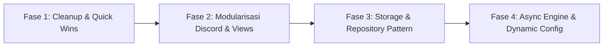

# Ayaka: Comprehensive Source Code Review, Architectural Audit & Refactoring Roadmap

**Project:** Ayaka — Autonomous Academic Synchronization, Reminder & AI Assistant Bot  
**Target Environment:** 24/7 VPS Daemon / Docker Container  
**Tech Stack:** Python 3.12+, Discord.py 2.3+, SQLite (WAL), HTTPX, Google Workspace APIs, Gemini/OpenAI API  
**Status:** Audit & Refactoring Proposal  
**Author:** AI Architecture & Engineering Reviewer  

---

## 1. Executive Summary

Proyek **Ayaka** telah berkembang dari skrip sinkronisasi sederhana menjadi sistem otonom multikomponen yang mengintegrasikan:
1. **LMS Scrapers & Fetchers:** Edunex ITB, SIX ITB (jadwal & modal pertemuan), Omnicampus, dan Gmail (Option C).
2. **Google Workspace Sync:** Google Tasks (checklist deadline), Google Calendar (jadwal kuliah & ujian).
3. **Discord Bot Interface:** Slash commands interaktif, UI pagination, action buttons, dan automated scheduled reminders (05:00 Briefing, Class Start, 10-Minute Attendance).
4. **AI Conversational Agent:** LLM deredere assistant dengan integrasi tool/function-calling untuk pengelolaan tugas.

Meskipun sistem saat ini berfungsi dengan baik, penambahan fitur yang cepat telah menimbulkan **technical debt**, **anti-pattern arsitektur**, dan **kemacetan performa (I/O bottlenecks)**. Total basis kode saat ini mencapai **5.679 baris Python (LOC)**, dengan lebih dari 31% terkonsentrasi pada satu file monolitik (`discord_bot.py`).

Dokumen ini menyajikan audit menyeluruh terhadap arsitektur dan kualitas kode Ayaka, menginventarisasi kelemahan teknis, mengidentifikasi kode/file mati, serta merancang arsitektur target berstandar **Clean Architecture & Production Best Practices**.

---

## 2. Metrik Basis Kode & Struktur Saat Ini

### 2.1 Distribusi Baris Kode (Lines of Code)

| File / Modul | LOC | Proporsi | Peran Utama | Kategori Isu |
|---|---|---|---|---|
| `ayaka/services/discord_bot.py` | 1.798 | 31.7% | Bot Discord, Views, Commands, Embed Formatters | **God Object**, Monolitik |
| `ayaka/storage/db.py` | 631 | 11.1% | Akses SQLite mentah untuk 6 entitas berbeda | **Tightly Coupled**, Connection Churn |
| `ayaka/services/ai_agent.py` | 579 | 10.2% | Integrasi LLM, persona prompt, parsing natural language | In-memory State Leak |
| `ayaka/fetchers/six.py` | 335 | 5.9% | Scraper SIX ITB (ujian & modal kalender) | Sequential Blocking HTTP |
| `ayaka/scheduler.py` | 306 | 5.4% | Loop latar belakang (sync, reminder, gmail) | Sync-to-thread Overhead |
| `ayaka/config.py` | 302 | 5.3% | Parsing `.env` dan `config.json` | Fallback Redundansi |
| `ayaka/cli.py` | 243 | 4.3% | CLI commands | Inkonsistensi Daemon Lifecycle |
| `ayaka/services/google_sync.py` | 239 | 4.2% | Integrasi Google Calendar & Tasks | Blocking OAuth Flow |
| `ayaka/services/schedule_service.py`| 227 | 4.0% | Koordinasi Google Calendar & modal SIX | Coupling dengan fetcher |
| `ayaka/fetchers/edunex.py` | 214 | 3.8% | Scraper API Edunex ITB | Hardcoded Period ID |
| `ayaka/task_filters.py` | 192 | 3.4% | Blacklist dan kriteria tugas | In-memory vs JSON mutation |
| `ayaka/fetchers/omnicampus.py` | 189 | 3.3% | Fetcher API Omnicampus | Hardcoded Course ID |
| `ayaka/dialogue.py` | 155 | 2.7% | Manajemen dialog karakter & fallback | Duplikasi format timestamp |
| `ayaka/fetchers/gmail_reader.py` | 98 | 1.7% | Polling Gmail API | Uncached Service Builder |
| `ayaka/main.py` | 90 | 1.6% | Entrypoint runner daemon | Entri ganda terpisah dari CLI |
| `ayaka/fetchers/base.py` | 82 | 1.4% | Kontrak dasar fetcher | Ketidaksesuaian tipe return |
| **Total** | **5.679** | **100%** | **16 File Python** | — |

---

## 3. Daftar Kelemahan & Code Smells (Technical Debt)

### 3.1 `ayaka/services/discord_bot.py`: God Object & Pelanggaran SRP
- **Masalah:** File ini memiliki panjang ~1.800 baris dan memikul terlalu banyak tanggung jawab sekaligus:
  1. Koneksi dan lifecycle client bot Discord (`AyakaBot`).
  2. Implementasi Discord UI Component Views (`TaskActionView`, `AttendanceActionView`, `ClassStartActionView`, `TaskPaginationView`).
  3. Formatter visual embed untuk 6 jenis embed berbeda.
  4. Registrasi slash commands dan text commands melalui metode raksasa `_register_commands()` sepanjang **650 baris** yang menggunakan *nested closure functions*.
  5. Logika bisnis database dan update session credentials.
- **Dampak:** Sulit dilakukan pengujian unit (unit testing) pada command individual; tidak memungkinkan *hot-reloading* modul commands; sulit dinavigasi dan rentan regresi saat mengubah UI.
- **Best Practice Solution:** Memecah commands ke dalam **Discord Cogs** (`cogs/tasks.py`, `cogs/schedule.py`, `cogs/academic.py`, `cogs/ai.py`, `cogs/system.py`), memindahkan Views ke modul `ayaka/discord/views/`, dan formatters ke `ayaka/discord/formatters/`.

### 3.2 `ayaka/storage/db.py`: Connection Churn & Ketiadaan Repository Pattern
- **Masalah:**
  1. **Connection Churn:** Context manager `_conn()` membuka koneksi SQLite baru (`sqlite3.connect()`), mengeksekusi `PRAGMA journal_mode=WAL;` dan `PRAGMA busy_timeout=5000;`, menjalankan kueri, lalu menutup koneksi pada **setiap pemanggilan metode**. Dalam satu siklus sinkronisasi yang memproses 50 pertemuan dan 10 tugas, koneksi SQLite dibuka-tutup lebih dari 100 kali dalam hitungan detik.
  2. **Pelanggaran Abstraksi (Lack of Repositories):** Kelas `Database` bertindak sebagai *God Class* yang berisi puluhan kueri SQL mentah untuk 6 domain berbeda (`tasks`, `gmail_messages`, `sync_logs`, `schedule_reminders`, `session_alerts`, `lecture_meetings`).
  3. **Untyped Return Values:** Sebagian besar metode mengembalikan `sqlite3.Row` atau `dict[str, Any]` tanpa type safety atau dataclass domain.
  4. **Ketiadaan Migration System:** Migrasi skema hanya mengandalkan `CREATE TABLE IF NOT EXISTS` di `init_db()`. Tidak ada pelacakan versi skema jika terjadi perubahan kolom di masa mendatang.
- **Best Practice Solution:**
  - Mengadopsi **Repository Pattern** terpisah: `TaskRepository`, `MeetingRepository`, `SyncLogRepository`, `AlertRepository`.
  - Menggunakan koneksi persisten thread-safe (atau connection pool / `aiosqlite`) agar tidak melakukan handshake dan pragma berulang.
  - Mengembalikan objek domain yang kuat (`Task`, `Meeting`, `GmailAlert`).

### 3.3 `ayaka/fetchers/`: I/O Sinkronus & Blocking Event Loop
- **Masalah:** Seluruh fetcher (`edunex.py`, `six.py`, `omnicampus.py`) menggunakan `httpx.Client()` yang berbasis **sinkronus / blocking**.
- **Dampak:** Karena loop scheduler (`scheduler.py`) dan bot Discord berjalan di atas asyncio, pemanggilan fetcher harus dibungkus dengan `asyncio.to_thread()`. Ini memboroskan thread pool OS. Terlebih lagi, HTTP requests di dalam fetcher dilakukan secara berurutan (*sequential*), bukan paralel (*concurrent*):
  - Pada `six.py`, 29 modal pertemuan di-request satu per satu secara sekuensial (~2.5 detik).
  - Pada `edunex.py`, setiap mata kuliah di-request satu per satu secara sekuensial.
  - Pada `gmail_reader.py`, metadata email di-request satu per satu secara sekuensial.
- **Best Practice Solution:** Migrasi fetcher ke `httpx.AsyncClient` dengan `asyncio.gather()`. Pengambilan 29 modal SIX yang tadinya memakan waktu 2.5 detik dapat selesai dalam <500 ms secara paralel.

### 3.4 Hardcoded Constants & Identitas Mahasiswa
- **Masalah:** Terdapat nilai-nilai penting yang di-hardcode di dalam kode sumber:
  1. `ayaka/fetchers/six.py` (baris 177, 260): URL jadwal memuat NIM spesifik `mahasiswa:18223113+2026-1`.
  2. `ayaka/fetchers/edunex.py` (baris 85): `filter[period_id][is]=26` (Semester 1 2026 di-hardcode).
  3. `ayaka/fetchers/omnicampus.py` (baris 64): `course_ids = [170]` di-hardcode untuk mata kuliah GCI World.
- **Dampak:** Jika semester berganti (misal Semester 2 / Period 27) atau NIM berganti, bot akan gagal beroperasi kecuali kode sumber diubah secara manual.
- **Best Practice Solution:** Seluruh konstanta dinamis harus dipindahkan ke `config.json` atau dibaca secara otomatis dari metadata login.

### 3.5 `ayaka/services/ai_agent.py`: In-Memory Context Leak
- **Masalah:** Riwayat obrolan AI disimpan pada dictionary memori:
  ```python
  self.histories: Dict[str, List[Dict[str, Any]]] = {}
  ```
- **Dampak:**
  1. Setiap kali bot di-restart (misal deployment atau pembaruan kode), seluruh konteks percakapan pengguna langsung hilang seketika.
  2. Jika bot digunakan oleh banyak channel/user, dictionary ini akan menumpuk di RAM tanpa batas kedaluwarsa (*unbounded memory growth*).
- **Best Practice Solution:** Simpan riwayat chat ke dalam tabel SQLite (`ai_conversations`) dengan `user_id`, `role`, `content`, `timestamp`, serta batas TTL (misal 24 jam).

### 3.6 Duplikasi Logika Parsing Tanggal
- **Masalah:** Logika parsing teks tanggal alami diimplementasikan secara terpisah di dua tempat berbeda:
  - `ayaka/services/ai_agent.py`: `parse_natural_due_date()` (55 baris).
  - `ayaka/services/discord_bot.py`: `_parse_user_due_date()` (40 baris).
- **Dampak:** Inkonsistensi format (misal yang satu mendukung `jam 15`, yang lain tidak), serta duplikasi kode yang menyulitkan pengujian.
- **Best Practice Solution:** Ekstraksi ke modul utilitas tunggal `ayaka/utils/date_parser.py` dengan pengujian unit yang komprehensif.

### 3.7 Inkonsistensi Lifecycle CLI vs Daemon Bot
- **Masalah:**
  - `ayaka/main.py` mendefinisikan `DaemonBot(AyakaBot)` yang menjalankan 4 background loop (`reminder_loop`, `gmail_loop`, `academic_sync_loop`, `schedule_reminder_loop`).
  - `ayaka/cli.py` mendefinisikan subperintah `bot` yang memanggil `run_bot()`. `run_bot()` hanya menginstansiasi `AyakaBot` biasa **tanpa background task apa pun**.
- **Dampak:** Jika pengguna menjalankan bot via CLI (`ayaka bot`), bot akan online tetapi tidak ada notifikasi pengingat, sinkronisasi, atau Gmail alert yang berjalan sama sekali.
- **Best Practice Solution:** Unifikasi runner bot ke satu entry point standar yang selalu menyertakan scheduler lifecycle.

### 3.8 Docker & Deployment Vulnerabilities
- **Masalah:**
  1. `Dockerfile`: File `task_filters.json` tidak di-copy ke dalam container image pada baris `COPY`.
  2. `docker-compose.yml`: Volume mount `./task_filters.json:/app/task_filters.json:ro` diatur sebagai **Read-Only (`:ro`)**. Padahal bot memiliki perintah `/filter blacklist <id>` yang menulis ke file tersebut, yang akan memicu `PermissionError: Read-only file system`.
  3. `docker-compose.yml`: File `.env` tidak di-mount sebagai volume (hanya dibaca saat startup via `env_file`). Pembaruan cookie via `/session <platform>` hanya menulis ke filesystem kontainer sementara dan akan hilang saat kontainer di-recreate.
  4. Dependensi Usang: `pytz` tercantum di `requirements.txt` dan `pyproject.toml`, padahal Python 3.9+ sudah memiliki library standar `zoneinfo`. `pytz` sama sekali tidak digunakan di dalam kode.

---

## 4. File & Kode Mati yang Harus Dihapus (Dead Code)

Berikut adalah daftar file dan kode yang tidak lagi diperlukan dan aman untuk dihapus:

1. **Folder `scratch/`:**
   - Direktori kosong di root proyek yang tidak memiliki fungsi operasional.
   - *Tindakan:* Hapus direktori atau tambahkan ke `.gitignore`.
2. **Dependensi `pytz`:**
   - Ditemukan di `pyproject.toml` (baris 18) dan `requirements.txt` (baris 8).
   - Seluruh kode proyek telah sepenuhnya beralih ke `zoneinfo.ZoneInfo` bawaan Python 3.9+.
   - *Tindakan:* Hapus `pytz` dari `pyproject.toml` dan `requirements.txt`.
3. **Artifact Cache Python 3.14 (`__pycache__/*cpython-314.pyc`):**
   - Terdapat sisa kompilasi bytecode Python 3.14 di direktori `ayaka/__pycache__` dan `tests/__pycache__`, padahal runtime resmi adalah Python 3.12.
   - *Tindakan:* Bersihkan seluruh file `.pyc`.
4. **Fallback Redundan `_load_env_file` di `config.py`:**
   - `python-dotenv` sudah menjadi dependensi wajib yang terinstal di virtualenv dan Dockerfile. Parser `.env` manual di `config.py` (baris 17-34) merupakan kode redundan.

---

## 5. Arsitektur Target (Clean Architecture Proposal)

Untuk mencapai standar rekayasa perangkat lunak terbaik, performa tinggi, dan kemudahan pemeliharaan, arsitektur Ayaka disarankan direstrukturisasi menjadi struktur berikut:

```text
ayaka/
├── __init__.py
├── main.py                     # Entry point tunggal untuk CLI & Daemon
├── core/                       # Kernel & konfigurasi inti
│   ├── __init__.py
│   ├── config.py               # Pydantic v2 / Dataclass Typed Settings
│   ├── logging.py              # Centralized structured logger
│   ├── exceptions.py           # Domain exceptions (SessionExpired, FetchError, etc.)
│   └── time.py                 # Timezone & date parsing utilities
├── domain/                     # Entities & Data Contracts (Murni bisnis, bebas dependensi luar)
│   ├── __init__.py
│   ├── task.py                 # AcademicTask entity
│   ├── meeting.py              # LectureMeeting entity
│   ├── filter.py               # TaskFilter & Blacklist models
│   └── alert.py                # Reminder & Alert models
├── storage/                    # Layer Persistensi Data
│   ├── __init__.py
│   ├── connection.py           # Thread-safe connection pool / aiosqlite manager
│   ├── migrations.py           # Lightweight schema versioning
│   └── repositories/           # Repository Pattern
│       ├── task_repo.py        # Task CRUD & milestone queries
│       ├── meeting_repo.py     # Lecture meeting CRUD & range queries
│       ├── alert_repo.py       # Session & reminder dispatch logs
│       └── ai_context_repo.py  # Persistent chat memory repository
├── fetchers/                   # Asynchronous HTTP Fetchers
│   ├── __init__.py
│   ├── base.py                 # BaseAsyncFetcher abstract class
│   ├── edunex.py               # Edunex async fetcher (HTTP/2, dynamic period)
│   ├── six.py                  # SIX async scraper (concurrent modal fetch)
│   ├── omnicampus.py           # Omnicampus async fetcher (dynamic course IDs)
│   └── gmail.py                # Gmail API async reader (cached client)
├── services/                   # Application & Domain Services
│   ├── __init__.py
│   ├── sync_service.py         # Multi-platform sync coordinator
│   ├── schedule_service.py     # Google Calendar & SIX meeting bridge
│   ├── google_sync.py          # Google Tasks & Calendar synchronization
│   └── ai_agent.py             # LLM orchestration & async tool dispatcher
├── discord/                    # Interface Discord (Cogs Architecture)
│   ├── __init__.py
│   ├── bot.py                  # AyakaBot client & lifecycle hooks
│   ├── views/                  # Reusable Discord UI Components
│   │   ├── tasks_pagination.py
│   │   ├── task_actions.py
│   │   └── meeting_actions.py
│   ├── formatters/             # Embed & message builders
│   │   ├── schedule_embed.py
│   │   ├── task_embed.py
│   │   └── sync_embed.py
│   └── cogs/                   # Modular Discord Extensions
│       ├── academic_cog.py     # /tasks, /sync, /upcoming
│       ├── schedule_cog.py     # /schedule, class reminders
│       ├── admin_cog.py        # /session, /filter, /status, /ping
│       └── ai_cog.py           # /ai, natural language casual chat
└── scheduler/                  # Background Worker Orchestration
    ├── __init__.py
    ├── engine.py               # Background scheduler manager
    └── loops/
        ├── sync_loop.py
        ├── reminder_loop.py
        ├── gmail_loop.py
        └── schedule_loop.py
```

---

## 6. Spesifikasi Desain Refactoring per Komponen

### 6.1 Modularisasi Discord Bot dengan Cogs
- **Desain:**
  Pindahkan semua subperintah slash command dari fungsi monolitik `_register_commands()` ke dalam Discord Cogs terpisah:
  - `AcademicCog`: Menangani `/tasks`, `/upcoming`, `/sync`.
  - `ScheduleCog`: Menangani `/schedule` (today, tomorrow, week) dan pengiriman event embed.
  - `AdminCog`: Menangani `/status`, `/session`, `/filter`, `/ping`.
  - `AICog`: Menangani `@Ayaka` mention listener dan perintah `/ai`.
- **Keuntungan:**
  - File `bot.py` menyusut dari 1.800 LOC menjadi <150 LOC.
  - Perintah dapat di-reload secara langsung saat bot berjalan (`await bot.reload_extension("ayaka.discord.cogs.schedule_cog")`) tanpa memutus koneksi bot.
  - Pengujian terisolasi untuk tiap cog.

### 6.2 Pola Repository & Pengelolaan Koneksi SQLite
- **Desain:**
  Ganti kelas raksasa `Database` dengan:
  ```python
  class SQLiteManager:
      """Mengelola lifecycle koneksi tunggal per thread atau aiosqlite pool dengan WAL & timeout."""
  ```
  Dan repositori khusus per domain:
  - `TaskRepository(db_manager)`
  - `MeetingRepository(db_manager)`
  - `AlertRepository(db_manager)`
  - `AIConversationRepository(db_manager)`
- **Keuntungan:**
  - Mengeliminasi overhead buka-tutup koneksi SQLite 100+ kali per siklus sync.
  - Kueri SQL terkelompok rapi sesuai domain bisnis.
  - Memungkinkan pergantian engine basis data (misal PostgreSQL jika kelak dibutuhkan) tanpa mengubah kode logika bot.

### 6.3 Asynchronous Fetcher Engine (`httpx.AsyncClient`)
- **Desain:**
  Ubah kontrak `BaseFetcher` menjadi `BaseAsyncFetcher`:
  ```python
  class BaseAsyncFetcher(ABC):
      async def fetch_tasks(self) -> list[AcademicTask]: ...
  ```
  Pada `SixFetcher`:
  ```python
  async def fetch_lecture_meetings(self, fetch_modals: bool = True, future_only: bool = True) -> list[LectureMeeting]:
      # 1. Fetch calendar page async
      # 2. Parse all meetings
      # 3. Filter future meetings
      # 4. Fetch modals concurrently:
      tasks = [self._fetch_modal_async(client, m) for m in meetings]
      await asyncio.gather(*tasks)
  ```
- **Keuntungan:**
  - Waktu tunggu sync berkurang drastis dari beberapa detik menjadi beberapa ratus milidetik.
  - Menghilangkan kebutuhan wrapping `asyncio.to_thread()` yang berat pada scheduler.

### 6.4 Persistensi Riwayat Percakapan AI
- **Desain:**
  Tambahkan tabel SQLite `ai_conversations`:
  ```sql
  CREATE TABLE IF NOT EXISTS ai_conversations (
      id INTEGER PRIMARY KEY AUTOINCREMENT,
      user_id TEXT NOT NULL,
      role TEXT NOT NULL,
      content TEXT NOT NULL,
      created_at TEXT NOT NULL
  );
  CREATE INDEX IF NOT EXISTS idx_ai_user_time ON ai_conversations (user_id, created_at);
  ```
  Pada `AIAgent`:
  - Baca 10 percakapan terakhir pengguna dari `ai_conversations`.
  - Hapus percakapan yang lebih lama dari 48 jam secara otomatis.
- **Keuntungan:**
  - Riwayat obrolan tidak hilang saat bot di-restart.
  - Penggunaan memori RAM bot tetap konstan dan ringan.

---

## 7. Rencana Eksekusi Bertahap (Refactoring Roadmap)

Refactoring disarankan dilaksanakan dalam 4 fase terukur agar bot tetap dapat beroperasi tanpa *downtime* yang berkepanjangan:



### Fase 1: Quick Wins & Pembersihan Berkas Mati (Risiko: Rendah) — [SELESAI]
- [x] Hapus direktori kosong `scratch/`.
- [x] Hapus dependensi usang `pytz` dari `pyproject.toml` dan `requirements.txt`.
- [x] Bersihkan file cache `.pyc` Python 3.14.
- [x] Perbaiki `Dockerfile` (tambahkan `COPY task_filters.json .`).
- [x] Perbaiki `docker-compose.yml` (ubah mount `task_filters.json` menjadi read-write dan tambahkan mount `.env`).
- [x] Unifikasi date parser ke `ayaka/core/time.py`.

### Fase 2: Modularisasi Discord Bot & UI Views (Risiko: Sedang) — [SELESAI]
- [x] Ekstraksi class Views (`TaskActionView`, `AttendanceActionView`, `ClassStartActionView`, `TaskPaginationView`) ke `ayaka/discord/views/`.
- [x] Ekstraksi builder embed ke `ayaka/discord/formatters/`.
- [x] Pecah 650 baris `_register_commands()` ke dalam Discord Cogs terpisah (`AcademicCog`, `ScheduleCog`, `AdminCog`, `AICog`).
- [x] Pasang error handler global pada bot untuk menangani interaksi Discord yang gagal.

### Fase 3: Repository Pattern & Persistensi AI (Risiko: Sedang) — [SELESAI]
- [x] Buat `ayaka/storage/connection.py` dengan pengelolaan koneksi persisten/thread-local.
- [x] Pecah kelas `Database` menjadi `TaskRepository`, `MeetingRepository`, `AlertRepository`.
- [x] Tambahkan tabel `ai_conversations` dan hubungkan ke `AIAgent` agar konteks chat tersimpan persisten.
- [x] Sesuaikan seluruh unit test pada `tests/test_storage_and_milestones.py`.

### Fase 4: Async Fetchers & Konfigurasi Dinamis (Risiko: Tinggi) — [SELESAI]
- [x] Migrasikan `BaseFetcher` dan turunannya ke `httpx.AsyncClient`.
- [x] Terapkan `asyncio.gather()` untuk paralel modal fetch pada `SixFetcher` dan course scan pada `EdunexFetcher`.
- [x] Pindahkan `NIM`, `period_id`, dan `omnicampus course_ids` dari kode sumber ke `config.json` / `.env`.
- [x] Satukan entrypoint `cli.py` dan `main.py` agar subperintah CLI `ayaka bot` menggunakan `DaemonBot` secara konsisten.
- [x] Lengkapi unit test fetcher dengan mock HTTP (`pytest-httpx` / `unittest.mock`).

---

## 8. Kesimpulan & Rekomendasi Tindakan

Refactoring ini tidak mengubah fungsionalitas inti Ayaka yang sudah disukai pengguna, melainkan memperkuat fondasi internalnya agar:
1. **Lebih Cepat:** Pengambilan data paralel memangkas waktu tunggu sync hingga 80%.
2. **Lebih Andal:** Tidak ada memory leak pada riwayat AI, koneksi database lebih hemat, dan error handling Discord lebih tangguh.
3. **Mudah Dirawat:** Setiap modul berukuran <300 baris dengan tanggung jawab tunggal yang jelas (SRP).
4. **Bebas Nilai Hardcoded:** Siap digunakan untuk semester-semester berikutnya tanpa perlu mengedit kode sumber Python.

Dokumen ini siap dijadikan acuan utama untuk memulai refactoring secara bertahap.
